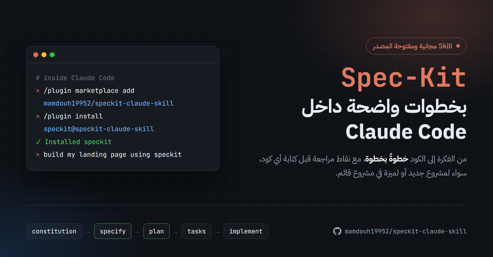

<p align="center">
  
</p>

<h1 align="center">Spec-Kit Skill for Claude Code</h1>

<p align="center">
  Turn your idea into well-structured code with <b>Spec-Driven Development</b> inside Claude Code,<br>
  step by step, without memorizing a single command.
</p>

<p align="center">
  
  <a href="https://github.com/github/spec-kit"></a>
  
  <a href="LICENSE"></a>
</p>

<p align="center">
  <a href="#english">English</a> · <a href="#العربية">العربية</a>
</p>

---

# English

## Overview

[GitHub Spec-Kit](https://github.com/github/spec-kit) is GitHub's official toolkit for *Spec-Driven Development*: you start with a clear specification, then a technical plan, then small tasks, and only then the implementation. Using it well, though, means knowing its commands, their order, and the right flags for each one.

This skill handles all of that for you. Tell Claude what you want to build, and it sets up the tooling, initializes the project, and guides you through each stage in order, pausing at every key stage for your review.

> [!NOTE]
> This skill complements the official Spec-Kit CLI; it doesn't replace it. The CLI itself is installed on your machine as described below.

## Features

- **Automatic tooling setup**: checks for `uv` and `specify` and installs them when missing.
- **Correct project initialization**: runs `specify init` with the right flags for Claude Code, in a new or an existing project.
- **Ordered stages**: from the project constitution through implementation, with no step skipped.
- **Review gates**: no code is written until you approve the spec and the plan.
- **Project-aware**: if Spec-Kit is already set up, it goes straight to the new feature without re-initializing.
- **Arabic and RTL support**: a dedicated checklist for right-to-left UI quality.

## Workflow

<p align="center">
  <code>constitution</code> → <b><code>specify</code></b> ✅ → <code>clarify</code> → <b><code>plan</code></b> ✅ → <b><code>checklist</code></b> ✅ → <code>tasks</code> → <code>analyze</code> → <code>implement</code>
</p>

The stages marked ✅ are **review gates**: Claude summarizes what was produced and waits for your approval before moving on.

---

## Requirements

| Tool | Purpose |
|---|---|
| **Claude Code** | Where the skill runs |
| **Git** | Required to install `specify` from GitHub |
| **uv** | Python tool manager; installs `specify` and downloads Python automatically if needed |
| **specify-cli** | The Spec-Kit CLI itself |

<details>
<summary><b>Install on macOS</b></summary>

<br>

Open **Terminal** and run:

```bash
# 1) Git (if not installed)
xcode-select --install

# 2) Claude Code
curl -fsSL https://claude.ai/install.sh | bash

# 3) uv
curl -LsSf https://astral.sh/uv/install.sh | sh
```

Close and reopen Terminal, then:

```bash
# 4) specify-cli
uv tool install specify-cli --from git+https://github.com/github/spec-kit.git
```

</details>

<details>
<summary><b>Install on Windows</b></summary>

<br>

Open **PowerShell** and run:

```powershell
# 1) Git (if not installed)
winget install --id Git.Git -e

# 2) Claude Code
irm https://claude.ai/install.ps1 | iex

# 3) uv
powershell -ExecutionPolicy ByPass -c "irm https://astral.sh/uv/install.ps1 | iex"
```

Close and reopen PowerShell, then:

```powershell
# 4) specify-cli
uv tool install specify-cli --from git+https://github.com/github/spec-kit.git
```

</details>

**Verify the installation:**

```bash
git --version && claude --version && uv --version && specify --version
```

> [!TIP]
> If you get `specify: command not found`, run `uv tool update-shell` and open a new terminal.

---

## Installation

### Option 1: As a plugin (recommended)

Open Claude Code (run `claude` in your terminal) and enter:

```
/plugin marketplace add mamdouh19952/speckit-claude-skill
/plugin install speckit@speckit-claude-skill
```

Then restart Claude Code. To get the latest version later:

```
/plugin marketplace update speckit-claude-skill
```

### Option 2: Manual copy

Copy the `plugins/speckit/skills/speckit-workflow` folder into one of these locations:

| Scope | macOS | Windows |
|---|---|---|
| All projects | `~/.claude/skills/` | `%USERPROFILE%\.claude\skills\` |
| One project | `<project>/.claude/skills/` | `<project>\.claude\skills\` |

<details>
<summary>Copy commands</summary>

<br>

**macOS:**

```bash
git clone https://github.com/mamdouh19952/speckit-claude-skill.git
mkdir -p ~/.claude/skills
cp -R speckit-claude-skill/plugins/speckit/skills/speckit-workflow ~/.claude/skills/
```

**Windows (PowerShell):**

```powershell
git clone https://github.com/mamdouh19952/speckit-claude-skill.git
New-Item -ItemType Directory -Force "$env:USERPROFILE\.claude\skills"
Copy-Item -Recurse speckit-claude-skill\plugins\speckit\skills\speckit-workflow "$env:USERPROFILE\.claude\skills\"
```

</details>

---

## Usage

Open Claude Code in your project folder and describe what you want in plain language, mentioning **speckit**:

```
Build a small online store with Laravel + Blade using speckit
```

```
Add a monthly reports feature to this project using speckit
```

### Supported scenarios

The skill detects your project's state automatically:

| Scenario | What the skill does |
|---|---|
| **New project** (empty folder) | Initializes Spec-Kit → project constitution → first feature |
| **Existing project**, no Spec-Kit yet | Reads the current code → safe init that leaves your files untouched → constitution derived from your existing code style → the new feature |
| **Project already using Spec-Kit** | Goes straight to `/speckit-specify` with no new init or constitution, and creates the next feature folder in `specs/` (e.g. `specs/004-coupons/`) |

> [!TIP]
> In an existing project without a `CLAUDE.md`, the skill suggests running `/init` first so Claude understands the codebase. It's optional but helpful.

### Spec-Kit commands

| # | Command | Purpose |
|:-:|---|---|
| 1 | `/speckit-constitution` | Project principles, **once** per project |
| 2 | `/speckit-specify` | Feature description → `specs/001-name/spec.md` |
| 3 | `/speckit-clarify` | Questions that resolve ambiguities in the spec *(optional, recommended)* |
| 4 | `/speckit-plan` | Technical plan and data model |
| 5 | `/speckit-checklist` | Requirements quality review (UX, RTL, accessibility) |
| 6 | `/speckit-tasks` | Breaks the plan into small, actionable tasks |
| 7 | `/speckit-analyze` | Checks that spec, plan, and tasks are consistent *(optional)* |
| 8 | `/speckit-implement` | Executes the tasks and writes the code |

You don't need to type these yourself; Claude runs them in order.

**Tips:**
- Give each complete feature (login, products, cart...) its own `/speckit-specify`.
- Fast path: constitution → specify → plan → tasks → implement.
- For an Arabic project, mention RTL in the feature description and the skill will run its RTL checklist.

---

## Good to know

- **Commands after init**: in the same session that ran `specify init`, the `/speckit-...` commands don't appear in the menu yet. That's expected, and Claude runs the stages from their files directly. From the next session on, the commands are available.
- **Checklist items**: generated unchecked on purpose so you review them yourself. Claude shows them to you and only starts implementing after you approve.
- **Command naming**: older Spec-Kit versions use a dot (`/speckit.specify`), newer ones a hyphen (`/speckit-specify`). Both are the same command.
- **Init command**: the skill runs `specify init --here --force --non-interactive --integration claude`. Without `--integration claude`, a non-interactive init defaults to GitHub Copilot; without `--force`, it refuses to run in a non-empty folder.

---

## FAQ

<details>
<summary><b>What's the difference between <code>constitution.md</code> and <code>CLAUDE.md</code>?</b></summary>

<br>

| File | Created by | Contents |
|---|---|---|
| `.specify/memory/constitution.md` | `/speckit-constitution` | Project principles: coding, testing, and security rules |
| `CLAUDE.md` | Claude Code (`/init`) or you | Context Claude reads every session: the stack, run commands |

The two are independent; `specify init` neither creates nor modifies `CLAUDE.md`.

</details>

<details>
<summary><b>Does <code>specify init</code> modify my existing files?</b></summary>

<br>

No. It only adds the `.specify/` folder and the Spec-Kit commands under `.claude/skills/`. It doesn't touch your code, `CLAUDE.md`, or `.claude/settings.json`, and re-running it keeps your constitution and `specs/` folder as they are.

</details>

<details>
<summary><b>Does it work with ChatGPT?</b></summary>

<br>

No. It's built specifically for **Claude Code**'s skills and plugins system, and there's no direct way to install it in ChatGPT.

</details>

---

## License

Released under the [MIT](LICENSE) license © Mamdouh.

---

<div dir="rtl">

# العربية

<p>حوِّل فكرتك إلى كود منظَّم بمنهجية <b>Spec-Driven Development</b> داخل Claude Code، خطوةً بخطوة ودون الحاجة إلى حفظ أي أوامر.</p>

## نظرة عامة

[GitHub Spec-Kit](https://github.com/github/spec-kit) أداة رسمية من GitHub لبناء البرمجيات بمنهجية *Spec-Driven Development*: تبدأ بمواصفات واضحة، ثم خطة تقنية، ثم مهام صغيرة، وأخيرًا التنفيذ. غير أن استخدامها يتطلّب معرفة أوامرها وترتيبها والخيارات الصحيحة لكلٍّ منها.

هذه الـ Skill تتولّى ذلك عنك. اطلب من Claude ما تريد بناءه، وسيتكفّل بتجهيز الأدوات وتهيئة المشروع وقيادتك عبر المراحل بالترتيب، مع التوقّف عند كل مرحلة مهمة لمراجعتك.

> **ملاحظة:** هذه الـ Skill مكمِّلة لأداة Spec-Kit الرسمية وليست بديلًا عنها؛ الأداة نفسها تُثبَّت على جهازك كما هو موضَّح أدناه.

## المزايا

- **تجهيز تلقائي للأدوات**: تتحقّق من وجود `uv` و`specify` وتثبّتهما عند الحاجة.
- **تهيئة صحيحة للمشروع**: تشغّل `specify init` بالخيارات المناسبة لـ Claude Code، سواء في مشروع جديد أو قائم.
- **مراحل مرتَّبة**: من دستور المشروع حتى التنفيذ، دون تخطّي أي خطوة.
- **نقاط مراجعة**: لا يُكتب أي كود قبل أن تعتمد المواصفات (spec) والخطة (plan).
- **وعي بحالة المشروع**: إن كان Spec-Kit مُهيَّأً مسبقًا، تبدأ مباشرةً بالميزة الجديدة دون إعادة التهيئة.
- **دعم العربية وRTL**: قائمة تحقّق مخصّصة لجودة الواجهات العربية.

## سير العمل

<p align="center" dir="ltr">
  <code>constitution</code> → <b><code>specify</code></b> ✅ → <code>clarify</code> → <b><code>plan</code></b> ✅ → <b><code>checklist</code></b> ✅ → <code>tasks</code> → <code>analyze</code> → <code>implement</code>
</p>

المراحل المميَّزة بالعلامة ✅ هي **نقاط المراجعة**: يعرض Claude ملخّصًا لما أُنجز وينتظر موافقتك قبل المتابعة.

---

## المتطلبات

| الأداة | الغرض |
|---|---|
| **Claude Code** | البيئة التي تعمل داخلها الـ Skill |
| **Git** | لازم لتثبيت `specify` من GitHub |
| **uv** | مدير أدوات Python؛ يثبّت `specify` وينزّل Python تلقائيًا إن لم يكن موجودًا |
| **specify-cli** | أداة Spec-Kit نفسها |

<details>
<summary><b>التثبيت على macOS</b></summary>

<br>

افتح **Terminal** ونفّذ:

</div>

```bash
# 1) Git (إن لم يكن مثبَّتًا)
xcode-select --install

# 2) Claude Code
curl -fsSL https://claude.ai/install.sh | bash

# 3) uv
curl -LsSf https://astral.sh/uv/install.sh | sh
```

<div dir="rtl">

أغلق الـ Terminal وافتحه من جديد، ثم:

</div>

```bash
# 4) specify-cli
uv tool install specify-cli --from git+https://github.com/github/spec-kit.git
```

<div dir="rtl">

</details>

<details>
<summary><b>التثبيت على Windows</b></summary>

<br>

افتح **PowerShell** ونفّذ:

</div>

```powershell
# 1) Git (إن لم يكن مثبَّتًا)
winget install --id Git.Git -e

# 2) Claude Code
irm https://claude.ai/install.ps1 | iex

# 3) uv
powershell -ExecutionPolicy ByPass -c "irm https://astral.sh/uv/install.ps1 | iex"
```

<div dir="rtl">

أغلق PowerShell وافتحه من جديد، ثم:

</div>

```powershell
# 4) specify-cli
uv tool install specify-cli --from git+https://github.com/github/spec-kit.git
```

<div dir="rtl">

</details>

**للتحقّق من التثبيت:**

</div>

```bash
git --version && claude --version && uv --version && specify --version
```

<div dir="rtl">

> 💡 إذا ظهرت رسالة `specify: command not found`، نفّذ `uv tool update-shell` ثم افتح الـ terminal من جديد.

---

## التثبيت

### الطريقة الأولى: عبر نظام الإضافات (موصى بها)

افتح Claude Code (بكتابة `claude` في الـ terminal) ونفّذ:

</div>

```
/plugin marketplace add mamdouh19952/speckit-claude-skill
/plugin install speckit@speckit-claude-skill
```

<div dir="rtl">

ثم أعد تشغيل Claude Code. وللحصول على أحدث إصدار لاحقًا:

</div>

```
/plugin marketplace update speckit-claude-skill
```

<div dir="rtl">

### الطريقة الثانية: النسخ اليدوي

انسخ المجلد `plugins/speckit/skills/speckit-workflow` إلى أحد المسارين:

| النطاق | macOS | Windows |
|---|---|---|
| جميع المشاريع | `~/.claude/skills/` | `%USERPROFILE%\.claude\skills\` |
| مشروع واحد | `<project>/.claude/skills/` | `<project>\.claude\skills\` |

<details>
<summary>أوامر النسخ</summary>

<br>

**macOS:**

</div>

```bash
git clone https://github.com/mamdouh19952/speckit-claude-skill.git
mkdir -p ~/.claude/skills
cp -R speckit-claude-skill/plugins/speckit/skills/speckit-workflow ~/.claude/skills/
```

<div dir="rtl">

**Windows (PowerShell):**

</div>

```powershell
git clone https://github.com/mamdouh19952/speckit-claude-skill.git
New-Item -ItemType Directory -Force "$env:USERPROFILE\.claude\skills"
Copy-Item -Recurse speckit-claude-skill\plugins\speckit\skills\speckit-workflow "$env:USERPROFILE\.claude\skills\"
```

<div dir="rtl">

</details>

---

## الاستخدام

افتح Claude Code داخل مجلد المشروع، واكتب طلبك بشكل طبيعي مع ذكر **speckit**، مثل:

</div>

```
Build a small online store with Laravel + Blade using speckit
```

<div dir="rtl">

أو بالعربية:

</div>

```
أريد إضافة ميزة التقارير الشهرية لهذا المشروع باستخدام speckit
```

<div dir="rtl">

### الحالات المدعومة

تتعرّف الـ Skill تلقائيًا على حالة مشروعك:

| الحالة | ما تقوم به الـ Skill |
|---|---|
| **مشروع جديد** (مجلد فارغ) | تهيئة Spec-Kit ← دستور المشروع ← أول ميزة |
| **مشروع قائم** لم يُستخدم فيه Spec-Kit | قراءة الكود الحالي ← تهيئة آمنة لا تمسّ ملفاتك ← دستور مستخلَص من أسلوب الكود الحالي ← الميزة الجديدة |
| **مشروع مُهيَّأ مسبقًا** بـ Spec-Kit | تبدأ مباشرةً من `/speckit-specify` دون تهيئة أو دستور جديد، وتُنشئ مجلد الميزة التالي في `specs/` (مثل `specs/004-coupons/`) |

> 💡 في المشروع القائم الذي لا يحتوي على `CLAUDE.md`، ستقترح عليك الـ Skill تشغيل `/init` أولًا ليتعرّف Claude على المشروع. الخطوة اختيارية لكنها مفيدة.

### أوامر Spec-Kit

| # | الأمر | الوظيفة |
|:-:|---|---|
| 1 | `/speckit-constitution` | مبادئ المشروع، **مرة واحدة** لكل مشروع |
| 2 | `/speckit-specify` | وصف الميزة ← `specs/001-name/spec.md` |
| 3 | `/speckit-clarify` | أسئلة لتوضيح أي غموض في المواصفات *(اختياري، ويُنصح به)* |
| 4 | `/speckit-plan` | الخطة التقنية ونموذج البيانات |
| 5 | `/speckit-checklist` | مراجعة جودة المتطلبات (UX، RTL، إمكانية الوصول) |
| 6 | `/speckit-tasks` | تقسيم الخطة إلى مهام صغيرة قابلة للتنفيذ |
| 7 | `/speckit-analyze` | التحقّق من اتساق spec وplan وtasks *(اختياري)* |
| 8 | `/speckit-implement` | تنفيذ المهام وكتابة الكود |

لست مضطرًا لكتابة هذه الأوامر بنفسك؛ Claude يشغّلها بالترتيب.

**نصائح:**
- خصِّص `/speckit-specify` مستقلًّا لكل ميزة متكاملة (تسجيل الدخول، المنتجات، سلة الشراء...).
- للمسار السريع: constitution ← specify ← plan ← tasks ← implement.
- إن كان المشروع عربيًّا، اذكر RTL في وصف الميزة لتُشغِّل الـ Skill قائمة التحقّق الخاصة به.

---

## ملاحظات مهمة

- **الأوامر بعد التهيئة**: في الجلسة نفسها التي نُفِّذ فيها `specify init` لن تظهر أوامر `/speckit-...` في القائمة بعد. هذا سلوك طبيعي، ويتابع Claude المراحل من ملفاتها مباشرةً. ابتداءً من الجلسة التالية تصبح الأوامر متاحة.
- **قائمة التحقّق**: تُنشأ بنود الـ checklist غير محدَّدة عن قصد، لتراجعها بنفسك. يعرضها Claude عليك، ولا يبدأ التنفيذ إلا بعد موافقتك.
- **تسمية الأوامر**: الإصدارات القديمة من Spec-Kit تستخدم النقطة (`/speckit.specify`)، والحديثة تستخدم الشَّرطة (`/speckit-specify`). كلاهما الأمر نفسه.
- **أمر التهيئة**: تستخدم الـ Skill الأمر `specify init --here --force --non-interactive --integration claude`. بدون `--integration claude` تختار التهيئة GitHub Copilot افتراضيًا، وبدون `--force` ترفض العمل في مجلد غير فارغ.

---

## أسئلة شائعة

<details>
<summary><b>ما الفرق بين <code>constitution.md</code> و<code>CLAUDE.md</code>؟</b></summary>

<br>

| الملف | من يُنشئه | محتواه |
|---|---|---|
| `.specify/memory/constitution.md` | `/speckit-constitution` | مبادئ المشروع: قواعد كتابة الكود والاختبارات والأمان |
| `CLAUDE.md` | Claude Code (`/init`) أو أنت | معلومات يقرؤها Claude في كل جلسة: الـ stack وأوامر التشغيل |

الملفان مستقلّان؛ `specify init` لا يُنشئ `CLAUDE.md` ولا يعدّله.

</details>

<details>
<summary><b>هل يعدّل <code>specify init</code> ملفات مشروعي الحالي؟</b></summary>

<br>

لا. يضيف المجلد `.specify/` وأوامر Spec-Kit داخل `.claude/skills/` فقط، ولا يمسّ الكود ولا `CLAUDE.md` ولا `.claude/settings.json`. وعند إعادة التهيئة يحتفظ بدستور المشروع ومجلد `specs/` كما هما.

</details>

<details>
<summary><b>هل تعمل الـ Skill مع ChatGPT؟</b></summary>

<br>

لا. صُمِّمت خصيصًا لنظام الـ Skills والإضافات في **Claude Code**، ولا توجد طريقة تثبيت مباشرة لها على ChatGPT.

</details>

---

## الترخيص

مرخَّص بموجب [MIT](LICENSE) © ممدوح.

</div>
